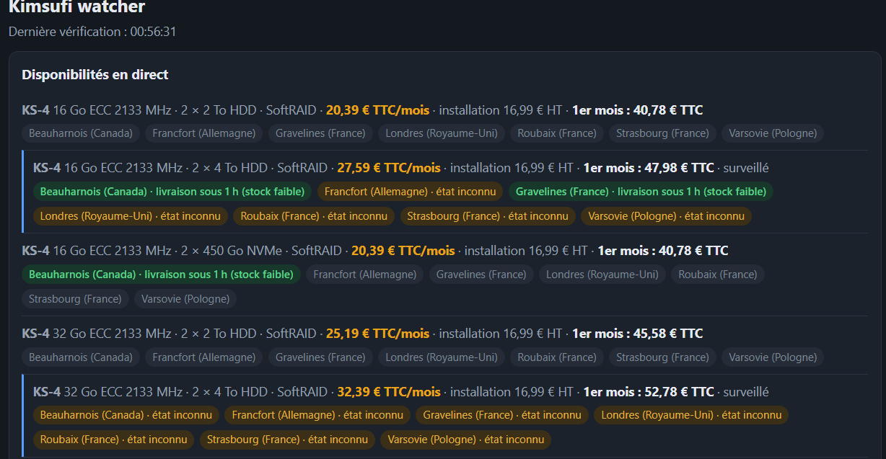
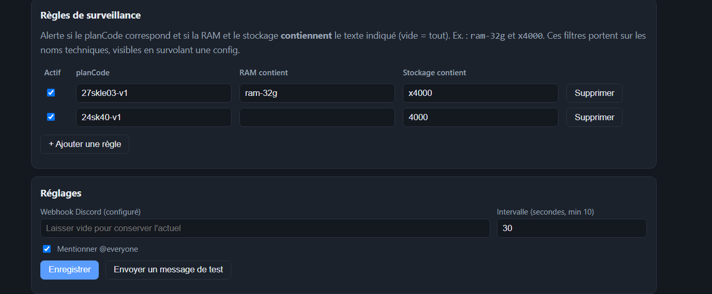

<p align="center">
  
</p>

<h1 align="center">Kimsufi watcher</h1>

<p align="center">
  Surveille les disponibilités des serveurs Kimsufi / OVH Eco et envoie des alertes Discord.
</p>
<p align="center">
  
</p>
<p align="center">
  
</p>

## Fonctionnalités

- Disponibilités en direct par datacenter
- Prix TTC/mois, frais d'installation HT et total du 1er mois TTC
- Règles de surveillance (plan, RAM, stockage)
- Alertes Discord (avec mention @everyone en option)
- Historique des alertes
- Interface web protégée par mot de passe

## Installation (Docker)

```yaml
services:
  kimsufi-watcher:
    build: .
    ports:
      - "8080:8080"
    environment:
      KW_USER: admin
      KW_PASS: change-moi
      KW_DATA: /data
    volumes:
      - ./data:/data
    restart: unless-stopped
```

```bash
docker compose up -d --build
```

Puis ouvre `http://ton-serveur:8080`.

## Configuration

| Variable | Rôle | Défaut |
|---|---|---|
| `KW_USER` | Identifiant de l'interface | `admin` |
| `KW_PASS` | Mot de passe de l'interface | `changeme` |
| `KW_DATA` | Dossier de stockage (config, historique) | dossier de l'app |


### Règles de surveillance

Une alerte Discord part quand le `planCode` correspond et que la RAM et le stockage
**contiennent** le texte indiqué (vide = tout). Exemples : `ram-32g`, `x4000`.
Les noms techniques apparaissent en survolant une config dans la liste.

Le webhook Discord, l'intervalle et les règles se règlent dans l'interface.

> Lance gunicorn avec **un seul worker** (`-w 1`), sinon le thread de surveillance est dupliqué et les alertes arrivent en double.

## Avertissement

Projet indépendant, non affilié à OVHcloud. Kimsufi et OVHcloud sont des marques de leurs propriétaires.
Les prix proviennent du catalogue public OVH et peuvent différer de la 


commande finale.

## Licence

[MIT](LICENSE)
